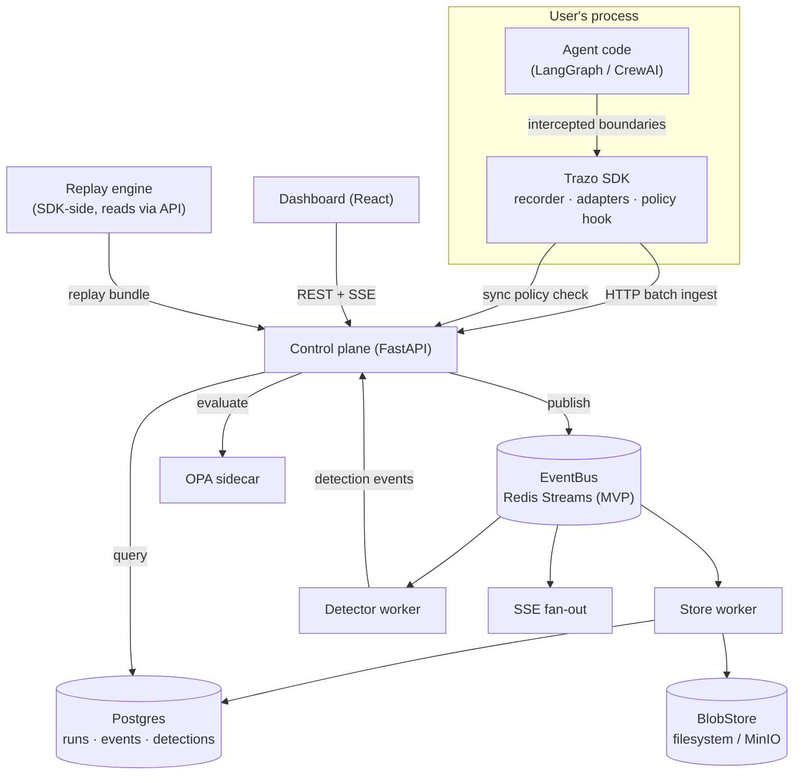

# Trazo — System Architecture

Owner of: system decomposition, component responsibilities, package
boundaries, data flow, runtime flow, lifecycles, security model,
configuration, error handling, logging. Event payloads live in
[EVENTS.md](EVENTS.md); storage in [DATABASE.md](DATABASE.md); HTTP contracts
in [API_SPEC.md](API_SPEC.md).

---

## 1. High-level component diagram



Three deployable units plus the SDK:

| Unit | Form | Contains |
|---|---|---|
| **SDK** | pip package `trazo` | recorder, adapters, policy hook, replay driver, CLI |
| **Control plane** | one FastAPI container | ingest API, query API, policy API, SSE fan-out, store worker, detector worker (workers run in-process for MVP; separable later) |
| **OPA** | sidecar container | policy evaluation, policies mounted from `policies/` |
| **Dashboard** | static React build | run list, timeline, step inspector, replay stepper |

Backing services: Postgres, Redis. Optional: MinIO, Ollama.
Everything runs from one `docker compose up`. (ADR-007)

## 2. Service breakdown and module responsibilities

### 2.1 SDK (`sdk/` → package `trazo`)

| Module | Single responsibility |
|---|---|
| `trazo.core.context` | Run/step context propagation (contextvars); IDs, sequencing |
| `trazo.core.recorder` | Turn intercepted boundary calls into events; buffer; batch-ship; spill to disk on network failure |
| `trazo.core.events` | Pydantic models of the event envelope + payloads (generated source of truth shared with control plane) |
| `trazo.core.fingerprint` | Canonical normalization + hashing of boundary-call inputs (shared by record and replay) |
| `trazo.core.policy` | Synchronous pre-action hook; local cache of policy decisions; fail-open/closed modes |
| `trazo.replay` | Replay driver: load bundle, substitute recorded I/O, divergence detection, step API |
| `trazo.integrations.langgraph` | LangGraph adapter (`instrument(graph)`) |
| `trazo.integrations.crewai` | CrewAI adapter (`instrument(crew)`) |
| `trazo.cli` | `trazo replay <run_id>`, `trazo verify <run_id>`, `trazo tail` |

**Boundary rule:** adapters may import `core`; `core` never imports an
adapter or any agent framework. `replay` imports `core` only. Framework
packages are optional extras (`pip install trazo[langgraph]`).

### 2.2 Control plane (`control-plane/` → package `trazo_server`)

| Module | Single responsibility |
|---|---|
| `trazo_server.api.ingest` | `POST /v1/ingest/events` — validate, ack, publish to bus |
| `trazo_server.api.query` | Runs/events/replay-bundle read endpoints |
| `trazo_server.api.policy` | `POST /v1/policy/evaluate` — delegate to OPA, record decision |
| `trazo_server.api.live` | SSE endpoint streaming per-run events |
| `trazo_server.bus` | `EventBus` interface + `RedisStreamsBus` implementation (ADR-002) |
| `trazo_server.store` | `TraceStore` (Postgres repo) + `BlobStore` (filesystem/MinIO) (ADR-010) |
| `trazo_server.workers.store_worker` | Consume bus → persist events, maintain run rollups |
| `trazo_server.workers.detector` | Consume bus → run rule detectors → emit detection events |
| `trazo_server.detectors` | Detector implementations (see [AI_DEBUGGER.md](AI_DEBUGGER.md)) |
| `trazo_server.config` | Settings (env-driven, pydantic-settings) |

**Boundary rule:** `api.*` never touches Postgres directly — always through
`store`. Workers never serve HTTP. `detectors` depend only on event models.

### 2.3 Dashboard (`dashboard/`)

React + TypeScript + Vite. TanStack Query for REST, native `EventSource` for
SSE. Pages: Runs, Run detail (timeline + step inspector + memory view +
detections), Replay stepper. The dashboard is a pure API consumer — zero
business logic; anything the dashboard computes that matters (e.g. cost
rollups) must come from the API instead.

### 2.4 Repository structure (monorepo, ADR-001)

```
trazo/
├── MASTER_PLAN.md, ARCHITECTURE.md, ... (this handbook)
├── DECISIONS/            # ADRs
├── TASKS/                # phase task breakdowns
├── sdk/                  # python package: trazo
│   ├── pyproject.toml
│   ├── src/trazo/
│   │   ├── core/         # context, recorder, events, fingerprint, policy
│   │   ├── replay/
│   │   ├── integrations/ # langgraph/, crewai/
│   │   └── cli/
│   └── tests/
├── control-plane/        # python package: trazo_server
│   ├── pyproject.toml
│   ├── src/trazo_server/
│   │   ├── api/  ├── bus/  ├── store/  ├── workers/  ├── detectors/
│   └── tests/
├── schema/               # THE canonical event schema (JSON Schema) + codegen
├── policies/             # OPA .rego policies + tests
├── dashboard/            # React app
├── demos/                # research-assistant/ (LangGraph), content-pipeline/ (CrewAI)
│   └── chaos/            # failure-injection harness
├── benchmark/            # fidelity + detection benchmark runners
├── deploy/               # docker-compose.yml, Dockerfiles, .env.example
├── scripts/smoke/        # per-phase end-to-end smoke scripts
└── .github/workflows/
```

`schema/` is the root of the dependency graph: both `trazo` and
`trazo_server` generate/validate their event models against it. A schema
change is a cross-cutting PR by definition and requires a version bump.

## 3. Data flow

**Record path (hot):**
agent boundary call → adapter → recorder (assign `seq`, fingerprint, capture
I/O) → local buffer → batch `POST /v1/ingest/events` → validate → ack →
publish to EventBus → fan-in consumers:
store worker (Postgres + blob offload for payloads > 32KB), detector worker,
SSE fan-out. Ingest acks after publish, not after persistence — the bus is
the durability handoff (Redis AOF on; at-least-once; consumers idempotent by
`(run_id, seq)`).

**Policy path (synchronous, latency-budgeted):**
adapter about to execute governed action → `policy.check(action_ctx)` →
local decision cache → on miss, `POST /v1/policy/evaluate` (budget: 150 ms)
→ OPA → decision recorded as `policy.decision` event → allow / deny /
escalate returned to the adapter, which raises `PolicyDenied` on deny.
Timeout behavior is configurable: `fail_open` (default, log loudly) or
`fail_closed`.

**Replay path (read):**
`trazo replay run_x` → `GET /v1/runs/{id}/replay-bundle` (ordered events +
inlined/streamed blobs) → replay driver re-drives agent control flow,
substituting recorded results at each boundary by `(boundary_kind,
fingerprint)` match — see [REPLAY_ENGINE.md](REPLAY_ENGINE.md).

## 4. Runtime lifecycles

**Trace lifecycle:** `run.started` → interleaved `step.*`, `llm.call`,
`tool.call`, `memory.*`, `agent.message`, `policy.decision` → terminal
`run.finished(status)`. A run with no terminal event after a TTL is marked
`stale` by the store worker (rollup job), never deleted.

**Agent lifecycle (as Trazo sees it):** instrument → run start → for each
framework step: step.started → zero or more boundary events → step.finished
(with state-hash checkpoint) → run end. The state hash per step is what
replay verification compares against.

**Detection lifecycle:** detector worker keeps per-run sliding windows →
threshold crossed → `detection.raised` event (with evidence event refs) →
persisted + streamed to dashboard → optionally referenced by policies
(e.g. "deny tool calls in runs with an active loop detection").

## 5. Security model (MVP-honest)

- Single static API key (`TRAZO_API_KEY`) required on ingest and policy
  endpoints; dashboard/query endpoints unauthenticated on localhost by
  default, bind-configurable. (ADR-009)
- Secrets never in events: recorder applies a redaction pass (configurable
  key patterns: `api_key`, `authorization`, `password`, ...) before ship.
- Blobs stored content-addressed (sha256) — no user-controlled paths.
- OPA policies are code-reviewed files mounted read-only; no runtime policy
  upload endpoint in MVP.
- Roadmap (not MVP): multi-tenant auth, RBAC, per-project keys, TLS
  everywhere. Design constraint honored now: every table already carries
  `project_id` so tenancy is additive, not a migration.

## 6. Configuration system

Both packages use pydantic-settings; every option has an env var with prefix
`TRAZO_`, a documented default, and appears in `deploy/.env.example`.
Precedence: explicit code kwargs > env > defaults. No config files in MVP
(one fewer format to document); the settings objects are the single schema
of record. Key knobs: `TRAZO_ENDPOINT`, `TRAZO_API_KEY`,
`TRAZO_POLICY_MODE=off|observe|enforce`, `TRAZO_POLICY_FAIL=open|closed`,
`TRAZO_BUFFER_MAX_EVENTS`, `TRAZO_REDACT_KEYS`, `TRAZO_BLOB_INLINE_MAX=32768`.

## 7. Error-handling strategy

- **SDK must never crash the host agent.** Every recorder/network failure
  degrades: buffer → disk spill (`.trazo/spool/`) → drop with a single rate-
  limited warning. The only exceptions the SDK ever raises into user code
  are `PolicyDenied` (by design) and `ReplayDivergence` (replay mode only).
- **Control plane:** problem-details JSON errors (`type`, `title`, `status`,
  `detail`); 4xx for caller faults, 5xx never leak internals; every 5xx
  logged with request ID.
- **Workers:** poison events go to a dead-letter stream
  (`trazo:events:dlq`) with the error attached, never block the consumer
  group; DLQ depth is a Prometheus metric with an alert threshold.
- **Idempotency everywhere:** event writes upsert on `(run_id, seq)`;
  re-delivery is normal, duplication is not an error.

## 8. Logging & observability of Trazo itself

- Structured JSON logs (structlog) with `request_id`, `run_id` where
  applicable; human-readable console renderer in dev.
- Prometheus `/metrics` on the control plane: ingest rate, bus lag, DLQ
  depth, policy-eval latency histogram, detector latency, SSE client count.
- `/healthz` (liveness) and `/readyz` (checks Postgres + Redis) on every
  service. Grafana dashboard JSON committed under `deploy/grafana/`.

## 9. Technology decisions (summary — details in ADRs)

| Decision | Choice | ADR |
|---|---|---|
| Repo layout | Monorepo | ADR-001 |
| Event transport | `EventBus` iface; Redis Streams MVP; Kafka later | ADR-002 |
| Trace store | Postgres only (MVP) | ADR-003 |
| Replay semantics | Record & substitute; never regenerate | ADR-004 |
| Schema alignment | Superset of OTel GenAI semconv, convertible | ADR-005 |
| Policy enforcement | Synchronous SDK hook + OPA sidecar | ADR-006 |
| Local orchestration | Docker Compose | ADR-007 |
| SDK language | Python first | ADR-008 |
| Auth | Static API key MVP | ADR-009 |
| Blob storage | `BlobStore` iface; filesystem MVP; MinIO optional | ADR-010 |
