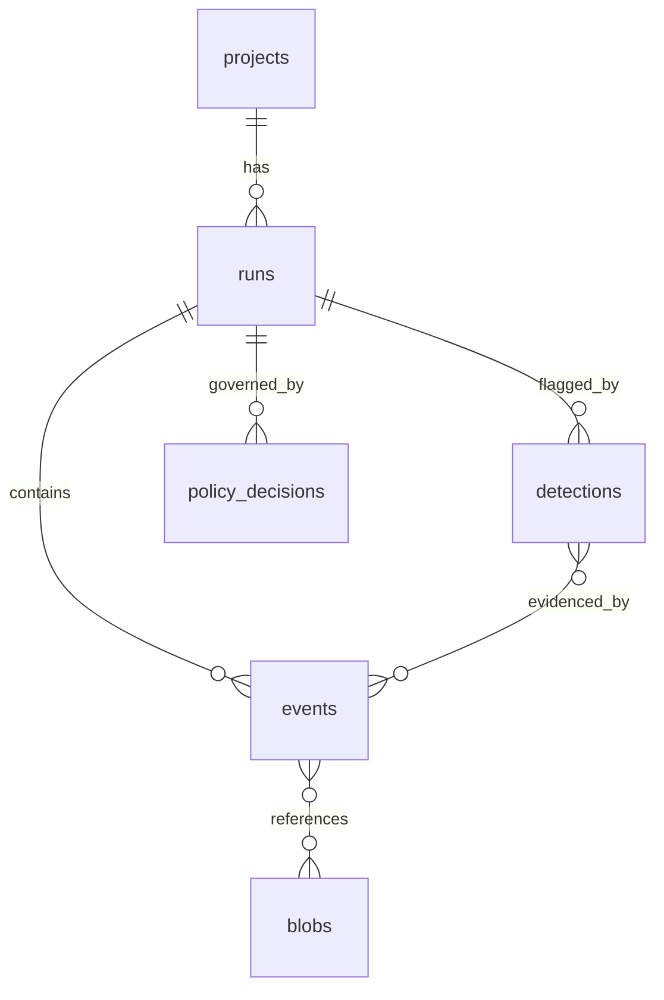

# Trazo — Database Design

Postgres 16 is the only required store (ADR-003). Migrations via Alembic,
in `control-plane/migrations/`, forward-only. All IDs are ULIDs stored as
`text` (sortable, no coordination). All timestamps `timestamptz`.

---

## 1. Entity-relationship overview



## 2. Tables

```sql
CREATE TABLE projects (
    project_id   text PRIMARY KEY,          -- ULID
    name         text UNIQUE NOT NULL,      -- e.g. "research-assistant"
    created_at   timestamptz NOT NULL DEFAULT now()
);

CREATE TABLE runs (
    run_id       text PRIMARY KEY,
    project_id   text NOT NULL REFERENCES projects,
    framework    text NOT NULL,             -- langgraph | crewai | custom
    status       text NOT NULL DEFAULT 'running',
                 -- running | ok | error | blocked | cancelled | stale
    started_at   timestamptz NOT NULL,
    finished_at  timestamptz,
    tags         jsonb NOT NULL DEFAULT '{}',
    -- rollups maintained by store worker on run.finished / periodic job:
    totals       jsonb NOT NULL DEFAULT '{}'
                 -- {events, llm_calls, tool_calls, cost_usd, tokens_in,
                 --  tokens_out, duration_ms}
);
CREATE INDEX runs_project_started ON runs (project_id, started_at DESC);
CREATE INDEX runs_status ON runs (status) WHERE status = 'running';

CREATE TABLE events (
    run_id       text NOT NULL REFERENCES runs,
    seq          bigint NOT NULL,
    event_id     text NOT NULL,
    kind         text NOT NULL,
    ts           timestamptz NOT NULL,
    step_id      text,
    agent_id     text,
    fingerprint  text,                      -- boundary events only
    payload      jsonb NOT NULL,            -- offloaded fields hold {"$blob": sha}
    blobs        jsonb NOT NULL DEFAULT '[]',
    PRIMARY KEY (run_id, seq)               -- idempotent upsert target
);
CREATE INDEX events_kind ON events (run_id, kind, seq);
CREATE INDEX events_fingerprint ON events (fingerprint) WHERE fingerprint IS NOT NULL;
CREATE INDEX events_payload_gin ON events USING gin (payload jsonb_path_ops);

CREATE TABLE blobs (
    sha256       text PRIMARY KEY,
    bytes        bigint NOT NULL,
    content_type text NOT NULL DEFAULT 'application/json',
    storage      text NOT NULL,             -- 'fs' | 'minio'
    ref          text NOT NULL,             -- path or object key
    created_at   timestamptz NOT NULL DEFAULT now()
);
-- content-addressed: identical payloads dedupe for free

CREATE TABLE detections (
    detection_id text PRIMARY KEY,
    run_id       text NOT NULL REFERENCES runs,
    detector     text NOT NULL,             -- loop | budget | thrash | drift
    severity     text NOT NULL,
    raised_at    timestamptz NOT NULL,
    evidence     jsonb NOT NULL,            -- [{run_id, seq}, ...]
    details      jsonb NOT NULL
);
CREATE INDEX detections_run ON detections (run_id);

CREATE TABLE policy_decisions (
    decision_id  text PRIMARY KEY,
    run_id       text NOT NULL REFERENCES runs,
    policy_id    text NOT NULL,
    action_kind  text NOT NULL,
    action_fp    text NOT NULL,
    decision     text NOT NULL,             -- allow | deny | escalate
    mode         text NOT NULL,             -- observe | enforce
    reasons      jsonb NOT NULL DEFAULT '[]',
    decided_at   timestamptz NOT NULL,
    eval_ms      integer
);
CREATE INDEX policy_decisions_run ON policy_decisions (run_id);
```

Notes:

- `events` is also written as a `policy.decision` / `detection.raised` kind
  (single timeline), while `policy_decisions` / `detections` are query-
  optimized projections maintained by the store worker. The event stream is
  authoritative; the projection tables are rebuildable.
- No `steps` table: steps are reconstructed from `step.*` events; a
  materialized view can be added if query patterns demand it (measured
  first — see philosophy #7).
- `project_id` on every query path now = multi-tenancy later without a
  migration (ADR-009 note).

## 3. Retention & growth

MVP: no automatic deletion; `trazo-server prune --keep-days N` manual
command. Blob dedupe keeps demo-scale storage trivial. Scale path
(ROADMAP): partition `events` by month, ClickHouse for analytics reads,
S3 lifecycle rules on blobs. The `TraceStore` interface keeps all of this
behind one seam.
