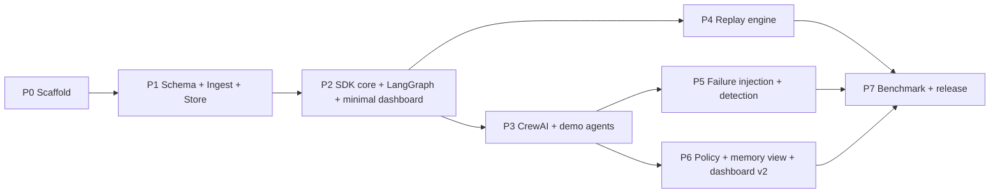

# Trazo — Implementation Plan

Decomposition: Project → Phases → Tasks (in [TASKS/](TASKS/)) → PR-sized
subtasks. Ordering is dependency order. Task IDs are `TRZ-P<phase>-<nn>`;
every PR title references exactly one.

---

## 1. Phase graph

P4 (replay) deliberately starts as soon as P2 lands, in parallel with P3 —
the two longest poles overlap instead of queueing.

## 2. Phase summaries, calendar mapping (12 weeks)

| Phase | Weeks | Output (integration checkpoint) |
|---|---|---|
| P0 Scaffold | 0.5 | Monorepo boots: compose up, CI green on empty packages, smoke script 0 passes |
| P1 Schema/Ingest/Store | 1.5 (w1–2) | Hand-crafted trace POSTs in, lands in Postgres, readable via query API; schema frozen v1 |
| P2 SDK + LangGraph + dash v1 | 2 (w3–4) | Toy LangGraph agent → live events → run visible in dashboard timeline |
| P3 CrewAI + demos | 1.5 (w5–6a) | Both demo agents generate realistic multi-step traces nightly in CI |
| P4 Replay | 3 (w5–8, parallel lane) | `trazo verify` ≥ 99% state fidelity on unchanged demo runs; divergence diffs on mutated code |
| P5 Chaos + detection | 2 (w8–10) | Injected corpus built; detectors scored; numbers reproducible offline |
| P6 Policy + memory + dash v2 | 1.5 (w10–11) | Cost-cap deny blocks a live tool call; memory reads visible per step; replay stepper in UI |
| P7 Benchmark + release | 1 (w12) | Benchmark tables regenerate from scripts; wheel installs; MVP demo (MASTER_PLAN §4.3) rehearsed |

## 3. Parallelization & ownership lanes

Designed so 3–4 agents/engineers work simultaneously with minimal overlap:

| Lane | Owns (write access) | Consumes (read-only contracts) |
|---|---|---|
| **A — Platform** | `control-plane/`, `deploy/`, `schema/` codegen plumbing | EVENTS.md, DATABASE.md, API_SPEC.md |
| **B — SDK** | `sdk/` | EVENTS.md, API_SPEC.md |
| **C — Frontend** | `dashboard/` | API_SPEC.md only |
| **D — Demos/Research** | `demos/`, `benchmark/`, `policies/` | SDK public API only |

Cross-lane changes (anything touching `schema/`) require a paired PR
review from lanes A + B and a schema version note. This is the merge-
conflict minimization strategy: the only shared file surface is `schema/`
and the handbook docs.

## 4. Task sizing & estimation conventions

Each task in TASKS/ carries: **Size** S (≤ half day) / M (≤ 2 days) /
L (≤ 5 days — must be decomposed before starting if any subtask is
separable); **Risk** low/med/high (high = unknowns that can invalidate
design — front-load these); **Deps** by task ID. Anything larger than L is
a phase, not a task.

## 5. Integration checkpoints (gate to close a phase)

Every phase defines a `scripts/smoke/phase<N>.sh` that runs against a clean
`docker compose up` and exits 0. CI runs the highest closed phase's smoke
on every merge to `main` (regression gate) and the current phase's smoke
nightly. A phase is closed by a PR that flips its status in ROADMAP.md and
must include the passing smoke run link.

## 6. Merge strategy

Trunk-based: short-lived branches `lane/task-id-slug` → PR → squash-merge
to `main`. No long-lived integration branches. `main` is always
demoable at the last closed checkpoint. Feature flags
(`TRAZO_FEATURE_*` env) gate half-landed vertical slices rather than
branches. See CONTRIBUTING.md for the PR checklist.

## 7. Risk register (top 5, tracked here, mitigations owned)

| Risk | Likelihood | Impact | Mitigation |
|---|---|---|---|
| Replay divergence rate too high on real frameworks | med | project-defining | P4 starts week 5 with 3 weeks; lookahead matching; per-adapter determinism aids; lenient mode still ships value |
| Framework API churn breaks adapters | med | med | Pinned version ranges; adapter CI matrix; hooks isolated per adapter module |
| LangChain callback gaps miss boundaries | med | high | P2 includes a boundary-coverage audit task (count intercepted vs. actual API calls via proxy in tests) |
| Detector thresholds overfit injected corpus | med | med (research credibility) | Clean-run FPR is a first-class metric; hold-out split of corpus |
| Scope creep into dashboard polish | high | med | Dashboard has a hard feature list (ARCHITECTURE §2.3); anything extra needs a MASTER_PLAN scope change |

## 8. Technical debt policy

Debt is allowed only with a `# DEBT(TRZ-xxx):` comment linking a filed
issue with a repayment phase. CI greps for `DEBT(` without an issue ref and
fails. Debt review is part of each phase-close PR.
