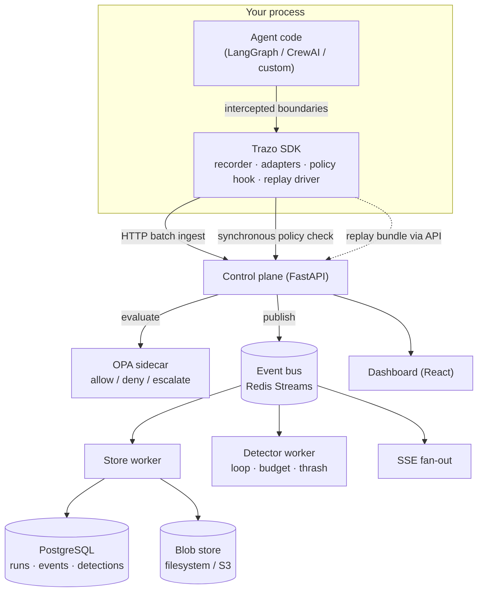

# Trazo

**Observability, replay, and governance for multi-agent AI systems.**

Trazo records what an autonomous agent actually did — every model call, tool
invocation, memory read, and state transition — then lets you replay that exact
run step by step, detect known failure patterns in it, and block unsafe actions
before they execute.

*Trazo* is Spanish and Portuguese for a drawn stroke: the mark a pen leaves
behind. That mark, applied to an agent's execution, is what this project is
about — the durable, inspectable record of what a system did, as opposed to what
its logs claim it did.

---

## Table of contents

- [The problem](#the-problem)
- [How Trazo compares](#how-trazo-compares)
- [Core capabilities](#core-capabilities)
- [Architecture](#architecture)
- [Replay under non-determinism](#replay-under-non-determinism)
- [Requirements](#requirements)
- [Quickstart](#quickstart)
- [Instrumenting your own agent](#instrumenting-your-own-agent)
- [Replaying and verifying a run](#replaying-and-verifying-a-run)
- [Writing policies](#writing-policies)
- [Failure detection](#failure-detection)
- [Configuration reference](#configuration-reference)
- [HTTP API reference](#http-api-reference)
- [Command-line reference](#command-line-reference)
- [Repository layout](#repository-layout)
- [Development](#development)
- [Benchmarks](#benchmarks)
- [Security posture](#security-posture)
- [Deployment](#deployment)
- [Project status](#project-status)
- [Roadmap](#roadmap)
- [Troubleshooting](#troubleshooting)
- [Contributing](#contributing)
- [License](#license)

---

## The problem

Multi-agent LLM systems built on LangGraph, CrewAI, AutoGen, or raw MCP
tool-calling loops fail in production in ways that are hard to see and harder to
explain. An agent loops on the same tool call forty times before a timeout kills
it. A budget guard trips at 2 a.m. because a planning step spiraled into
recursive sub-tasks. A retrieval step pulls the wrong document and the agent
confidently acts on it three steps later, far from where the actual mistake
happened.

When this happens, the honest answer to "why did the agent do that" is usually
that nobody knows, and there is no way to find out short of re-reading
unstructured logs and guessing. Standard application observability was built for
systems where a request either succeeds or fails in a deterministic, mostly
linear way. Agent systems are neither. They branch on model output, hold
long-lived state across many model calls, read and write memory, and make
irreversible tool calls whose consequences are not visible in a stack trace.

This gap appears the moment a team moves an agent from "impressive demo" to
"runs unsupervised in production," and it does not close as models improve. A
more capable model still makes decisions you need to inspect, reproduce, and —
when necessary — stop before they execute.

## How Trazo compares

| | Cross-framework | Self-hostable | Step-by-step deterministic replay | Pre-execution enforcement |
|---|---|---|---|---|
| **Trazo** | Yes | Yes | Yes | Yes |
| LangSmith | LangChain/LangGraph only | No (hosted only) | No | No |
| Langfuse | Yes | Yes | View only, not re-execution | No |
| Arize Phoenix | Yes | Yes | No (evaluation-focused) | No |
| OpenTelemetry GenAI | Yes (schema layer) | Yes | Out of scope | Out of scope |

Each of these tools is good at what it targets. LangSmith is tightly integrated
with the LangChain ecosystem. Langfuse offers solid open-source tracing and
evaluation. Phoenix is strong on dataset-driven output quality. OpenTelemetry's
GenAI semantic conventions standardize what an LLM span looks like, which is
genuinely useful — Trazo's event schema stays close to them deliberately.

What none of them provide is the combination in the table above: deterministic
re-execution of one specific historical run, unified across more than one agent
framework, with policy evaluated and enforced *before* an action runs. That
combination is what Trazo is for.

## Core capabilities

**Instrumentation SDK.** A Python library that hooks into an agent framework's
execution and emits structured trace events: state transitions, tool calls and
results, memory reads and writes, inter-agent messages, planning steps, and
human-in-the-loop checkpoints. A LangGraph state transition and a CrewAI task
handoff normalize to the same event shape, so the trace format does not fork per
framework.

**Ingestion and trace store.** Events ship in batches over HTTP, flow through an
event bus (Redis Streams), and land in PostgreSQL for structured querying. Large
payloads — a 200 KB scraped page does not belong in a relational row — are
content-addressed blobs stored on the filesystem or in S3-compatible object
storage. Every event is individually addressable by `(run_id, seq)`, which is
the granularity replay depends on.

**Replay engine.** Re-drives a recorded run's control flow while substituting
every non-deterministic result from the recorded trace. See
[Replay under non-determinism](#replay-under-non-determinism).

**Failure detection.** A worker consumes the live event stream and scores runs
against known degenerate patterns: tool-call loops, budget runaways, and
tool-call thrashing. Detections are raised while the run is still executing, not
after the fact. Measured precision and recall are published in
[Benchmarks](#benchmarks).

**Policy and governance.** Guardrails evaluated by Open Policy Agent immediately
*before* a governed action executes, with a 150 ms latency budget and explicit
fail-open or fail-closed configuration. Every decision is recorded as an event
in the same trace. Enforcement is inline and synchronous, which is what makes it
a governance layer rather than an audit log.

**Dashboard.** A React interface for the run timeline, per-step flow graph,
memory inspector, replay stepper, cost and latency breakdowns by model and tool,
incident feed, and policy decision log.

## Architecture

Two architectural decisions are worth calling out.

**Infrastructure sits behind narrow interfaces.** `EventBus`, `TraceStore`, and
`BlobStore` are protocols with the simplest working implementation chosen for
the current scope: Redis Streams rather than Kafka, PostgreSQL alone rather than
PostgreSQL plus a column store, a filesystem blob directory rather than
mandatory object storage. Heavier backends are additional implementations behind
the same seam, not rewrites.

**Policy enforcement is a synchronous SDK hook, not a bus consumer.** By the time
an asynchronous consumer observes an event, the action has already run.
Governance that only observes after the fact is reporting. The SDK therefore
calls the policy endpoint inline and raises before the governed call executes.

## Replay under non-determinism

This is the part of the system most likely to be quietly faked, so it is worth
being precise about what replay means here.

Model completions are sampled. Even at temperature zero, providers rotate weights
and deprecate versions without notice, and any tool call touching the outside
world can return something different five minutes later. Re-running the same
agent code against the same input will not, in general, reproduce the same trace.
A tool that simply runs it again is not replaying anything; it is producing a
second, uncorrelated run.

Temporal solved the adjacent problem for workflow code by recording every
non-deterministic operation's result in workflow history and satisfying each one
from that history on replay. The workflow code runs again; the outside world does
not.

Trazo applies the same idea to agent execution. Every model completion, tool
call, memory read, and external side effect during an instrumented run is
captured as a checkpointed trace event. Replay re-drives the agent's control flow
and, at each point where the original run made a non-deterministic call,
substitutes the recorded value instead of issuing a live one. You step through
exactly what the agent saw and decided at step *N* of a specific historical run.

**What this provides:** faithful, inspectable reconstruction of a specific
failure, with per-step divergence detection when replayed state does not match
what was recorded.

**What this does not provide:** prediction of what the agent would do on a fresh
run with fresh sampling. That is an evaluation problem, not a debugging one, and
is explicitly out of scope.

Replay requires an entrypoint registered in the same process, so the engine knows
which function to re-invoke for a given run — see
[Replaying and verifying a run](#replaying-and-verifying-a-run).

