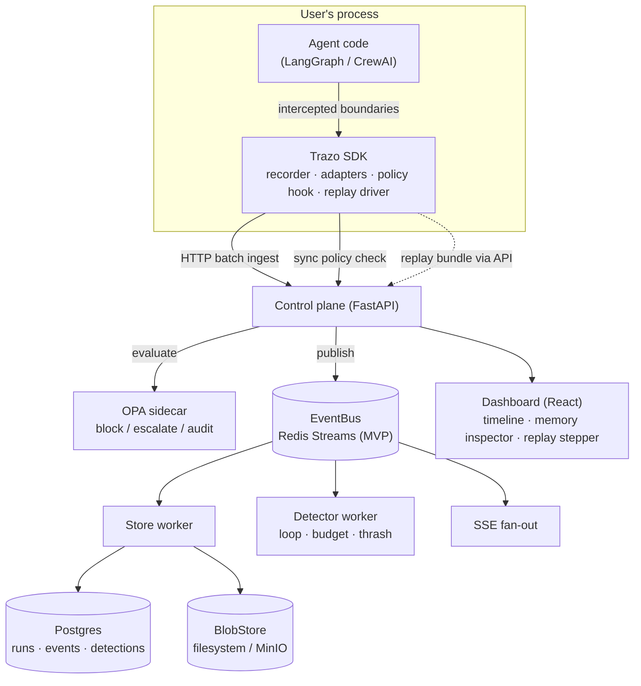

# Trazo

**Observability, replay, and governance for multi-agent AI systems.**

[](LICENSE)


*Trazo* is Spanish and Portuguese for a drawn stroke — the mark a pen leaves behind. That mark, applied to an agent's execution, is what this project is about: the durable, inspectable record of what an autonomous system actually did, as opposed to what its logs claim it did.

---

## The problem

Multi-agent LLM systems built on LangGraph, CrewAI, AutoGen, or raw MCP tool-calling loops fail in production in ways that are hard to see and harder to explain. An agent loops on the same tool call forty times before a timeout kills it. A budget guard trips at 2 a.m. because a planning step spiraled into recursive sub-tasks. A retrieval step pulls the wrong document and the agent confidently acts on it three steps later, far from where the actual mistake happened.

When this happens, the honest answer to "why did the agent do that" is usually: nobody knows, and there is no way to find out short of re-reading unstructured logs and guessing. Standard application observability (traces, metrics, logs) was built for systems where a request either succeeds or fails in a deterministic, mostly-linear way. Agent systems are neither — they branch on model output, hold long-lived state across many LLM calls, read and write memory, and make irreversible tool calls whose consequences aren't visible in a stack trace.

This is the same gap application debugging faced before Sentry, and the same gap distributed workflows faced before Temporal. It shows up the moment a team moves an agent from "impressive demo" to "runs unsupervised in production," and it does not go away as models get better — a more capable model still makes decisions you need to be able to inspect, replay, and, when necessary, stop before they execute.

## What exists today, and where it falls short

- **LangSmith** is well integrated with LangChain/LangGraph but is closed-source and hosted-only — you cannot self-host it or point it at a CrewAI or AutoGen agent.
- **Langfuse** is open-source and framework-agnostic, with solid tracing and evaluation support. Its run viewer lets you *look at* a past execution, but it does not deterministically *re-execute* one step at a time against the original state.
- **Arize Phoenix** is strong on evaluation and dataset-driven quality metrics, but it is built for measuring output quality, not for stepping through a single failing run to find where control flow went wrong.
- **OpenTelemetry's GenAI semantic conventions** standardize what a span for an LLM call looks like, which is genuinely useful, but OTel is a transport and schema layer — it has no opinion on replay, agent-specific failure detection, or pre-execution policy enforcement.

None of these give you a deterministic, step-by-step replay of a specific failed run, a way to unify traces across more than one agent framework, or a way to block an action *before* it executes based on a policy evaluated against the trace. That combination is what Trazo is for.

## What Trazo is

Trazo is an instrumentation SDK, trace store, and replay runtime for agent systems, plus two layers built on top of the trace data: an anomaly-detection agent that watches other agents' execution for known failure signatures, and a policy engine that can block or escalate an action before it runs.

The design goal is to be the layer that sits between agent frameworks (LangGraph and CrewAI first; AutoGen next on the roadmap) and the people who have to keep agents built on them running correctly — the same relationship Datadog has to application code, or Temporal has to workflow code, except purpose-built for the way agent systems actually fail.

## Architecture



Two deliberate architectural moves are worth calling out. First, every piece of infrastructure sits behind a small internal interface (`EventBus`, `TraceStore`, `BlobStore`), with the simplest implementation that works chosen for the MVP — Redis Streams rather than Kafka, Postgres alone rather than Postgres plus ClickHouse, a filesystem blob directory rather than mandatory MinIO. Heavier backends are swap-ins behind existing seams, not rewrites, and each of these choices is argued in a dedicated decision record ([DECISIONS/](DECISIONS/)). Second, policy enforcement is a synchronous SDK hook, not a consumer on the event pipeline — by the time an async consumer sees an event, the action has already run, and "governance" that observes after the fact is just reporting (ADR-006).

**Instrumentation SDK.** A Python (and later TypeScript) library that hooks into an agent framework's execution and emits structured trace events: state transitions, tool calls and their results, memory reads and writes, inter-agent messages, planning steps, and human-in-the-loop checkpoints. The event schema is designed to be framework-agnostic — a LangGraph state transition and a CrewAI task handoff both normalize to the same underlying event shape, and the schema is being kept close to OpenTelemetry's GenAI semantic conventions rather than reinventing a competing one, so existing OTel tooling isn't a dead end.

**Ingestion and trace store.** Trace events ship in batches over HTTP, flow through an `EventBus` (Redis Streams for the MVP; Kafka is a post-MVP implementation of the same interface, adopted only if measured ingest demands it), and land in Postgres for structured querying. Large tool-output payloads (a 200KB scraped webpage doesn't belong in a relational row) are content-addressed blobs behind a `BlobStore` interface — local filesystem by default, MinIO opt-in. Every event is an individually addressable unit keyed by `(run_id, seq)` — that granularity is what replay depends on.

**Replay engine.** The core technical bet of this project. See [Replay under non-determinism](#replay-under-non-determinism) below — this is the piece that separates Trazo from a trace viewer.

**Anomaly detection.** A detector worker that watches trace streams for degenerate patterns — infinite tool-call loops, budget runaways, tool-call thrashing, goal drift from the original task. The MVP is deliberately measurement-first: three rule-based detectors (a tool called with a near-identical input fingerprint N times with no state progress, cost velocity exceeding a rate cap, many distinct tools invoked with no state change) with published precision/recall against injected failures. A local LLM classifier (Qwen2.5 via Ollama, temperature 0, schema-forced output) for the harder, more semantic case of goal drift is a stretch goal behind the same detector interface — it is not something the benchmark depends on, because a benchmark should not depend on a 7B model's mood.

**Policy and governance engine.** Guardrails evaluated with Open Policy Agent *before* the governed action executes — for example, "block this tool call if projected cost exceeds $X" or "escalate to a human if this action touches a production data store." The SDK makes a synchronous policy check (150 ms budget, explicit fail-open/fail-closed configuration) immediately before executing side-effecting tool calls, and every decision is recorded as an event in the same trace. This is deliberately not a passive audit log: enforcement happens inline, which is what makes it a governance layer rather than a reporting feature.

**Memory inspector.** Visualizes what an agent's memory or vector-store retrieval actually returned at each step. Retrieval-driven mistakes are common and usually invisible in a normal trace view, because the trace shows the agent's *decision*, not what it was looking at when it made it.

**Dashboard.** A React frontend for the trace timeline, the step-by-step replay view, and per-step cost/latency/quality metrics.

## Replay under non-determinism

This is the part of the system most likely to be either the most interesting technical contribution here or the part that quietly gets faked, so it's worth being precise about what "replay" means and does not mean.

LLM completions are sampled. Even at temperature zero, model providers rotate weights and deprecate versions without notice, and any tool call that touches the outside world — a web search, a database query, a third-party API — can return a different result five minutes later. This means that literally re-running the same agent code against the same input will not, in general, reproduce the same trace. A replay tool that just "runs it again" is not replaying anything; it's producing a second, different, uncorrelated run.

Temporal solved an adjacent problem for general-purpose workflow code the same way: it doesn't require workflow code to be pure, it requires every non-deterministic operation (an "Activity") to have its result recorded in the workflow history, and replay re-executes the workflow's control flow while satisfying every one of those operations from the recorded history instead of a live call. The workflow code runs again; the outside world does not.

Trazo applies the same idea to agent execution. Every LLM completion, tool call, memory read, and external side effect during an instrumented run is captured verbatim as a checkpointed trace event. Replay re-drives the agent's control flow forward and, at each point where the original run made a non-deterministic call, substitutes the recorded value instead of issuing a live one. The result is that you can step through exactly what the agent saw and decided at step *N* of a specific historical run — not an approximation, not a "similar-looking" re-run.

What this buys you: faithful, inspectable reconstruction of a specific failure, and — as a further-out capability, not part of the initial scope — the ability to fork from a given step with one input or tool response changed, to see where a different outcome would have branched off. What it does not buy you: prediction of what the agent would do on a genuinely fresh run with fresh sampling, which is a different problem (closer to evaluation than debugging) and is out of scope for the replay engine specifically.

The two research questions this raises — how to define and measure "replay fidelity" when the underlying system is stochastic, and what the actual replay overhead is at scale — are the first entries in [Research direction](#research-direction) below, precisely because they don't have settled answers yet.

## Design preview: target developer experience

Nothing below is implemented yet — no package exists to install. This is included because architecture is easier to evaluate when you can see the shape of the API it implies, not just the boxes in a diagram. Treat it as a preview of the target design, subject to change once real usage puts pressure on it.

```python
# Instrumenting a LangGraph agent
from trazo.integrations.langgraph import instrument

graph = build_research_agent_graph()
traced_graph = instrument(graph, project="research-assistant")

result = traced_graph.invoke({"query": "..."})
# every state transition, tool call, and memory access in this run
# is now a durable, individually addressable trace event
```

```python
# Replaying a specific historical run, step by step
from trazo import replay

session = replay.load("run_01JABCDEF...", mode="strict")

for step in session.steps():
    print(step.index, step.name, step.state_before)
    # step.boundary_events holds the *recorded* llm/tool/memory calls
    # from the original run — not freshly generated ones
    step.verify()  # re-drive this step, compare against the recorded state hash
```

```rego
# A policy evaluated inline, before the action it governs executes
package trazo

deny[msg] {
    input.action.tool_name == "send_email"
    input.action.projected_cost_usd > 5
    msg := "blocked: projected cost exceeds per-action budget"
}
```

## Project status

This repository is at the end of its design phase and the start of implementation. The problem statement, system design, and technical bets are settled and written down in the [engineering handbook](#engineering-handbook); the repository scaffold (packages, local stack, CI) is in place; the product code is not yet built. There is no usable release, no running replay engine, and no benchmark results — any such claims elsewhere should be treated as aspirational until this section says otherwise.

| Component | Status |
|---|---|
| Engineering handbook (architecture, contracts, ADRs, task plan) | Complete — the binding design |
| Repository scaffold (packages, Docker Compose stack, CI, lint/type/test wiring) | In place (Phase 0) |
| Trace event schema | Specified in [EVENTS.md](EVENTS.md); machine-readable JSON Schema lands in Phase 1 |
| Instrumentation SDK (Python) | Not started (Phase 2) |
| LangGraph adapter | Not started (Phase 2) |
| CrewAI adapter | Not started (Phase 3) |
| Ingestion pipeline (HTTP → Redis Streams → Postgres) | Not started (Phase 1) |
| Replay engine | Not started (Phase 4) — the core open technical problem |
| Failure injection + anomaly detection | Not started (Phase 5) |
| Policy engine (OPA integration) | Not started (Phase 6) |
| Memory inspector + dashboard | Scaffold only; features land in Phases 2 and 6 |
| AutoGen adapter, TypeScript SDK, Kafka, ClickHouse, hosted tier | Deliberately deferred post-MVP ([ROADMAP.md](ROADMAP.md)) |

## Roadmap

The roadmap is ordered by dependency, not by calendar. Each phase produces something demonstrable, because the biggest risk to a project like this is polishing the easy 80% (a nice trace timeline) while quietly never building the hard 20% (real replay) that justifies the project existing. The replay phase deliberately runs as a long parallel lane starting mid-project — the full task breakdown lives in [TASKS/](TASKS/) and phase statuses in [ROADMAP.md](ROADMAP.md).

1. **P0 — Scaffold.** Monorepo boots: `docker compose up` brings up the stack, CI is green, every later task has a slot.
2. **P1 — Schema, ingest, store.** Event schema v1 frozen (JSON Schema + generated models); a hand-crafted trace flows HTTP → Redis Streams → Postgres and reads back idempotently.
3. **P2 — SDK core + LangGraph + dashboard v1.** A real LangGraph agent traced live into a minimal timeline view.
4. **P3 — CrewAI + demo agents.** Second adapter proves the cross-framework claim; two demo agents (a research assistant, a content pipeline) generate a realistic trace corpus nightly.
5. **P4 — Replay engine** (parallel lane, three weeks). Record-and-substitute replay with divergence detection and a fidelity harness — this is the milestone the rest of the project's credibility rests on.
6. **P5 — Failure injection + detection.** A chaos harness induces loops, budget overruns, thrash, and drift; rule-based detectors scored honestly against the labeled corpus.
7. **P6 — Policy, memory inspector, dashboard v2.** A cost-cap policy blocks a live tool call before it executes; retrieval results inspectable per step; replay stepper in the UI.
8. **P7 — Benchmark + release.** TrazoBench v0 regenerates from scripts; v0.1.0 tagged; the full demo runs unfaked.

## Research direction

Three open questions motivate the architecture above. None of these are solved by existing tooling, and none are claimed as solved here — they are the reason this project is structured the way it is, and they're listed as questions rather than results on purpose. The full experiment designs, metrics, and threats to validity live in [RESEARCH.md](RESEARCH.md).

1. **Deterministic replay for non-deterministic multi-agent systems.** Can step-by-step replay of an agent run be made reliable, using checkpointed state and recorded tool/model I/O, in a way that generalizes across agent frameworks rather than being bespoke to one? The relevant metrics are a replay-fidelity rate (does replayed state match the original at each step), divergence localization accuracy, and replay overhead.
2. **A failure taxonomy and detection framework for agentic workflows.** What are the recurring failure signatures in multi-agent execution — loops, budget runaways, tool-call thrashing, goal drift — and can a lightweight hybrid detector (rules plus a small local model) catch them reliably? The relevant metrics are precision/recall against injected failures and, just as important, the false-positive rate against runs that are unusual but legitimate.
3. **An open benchmark for agent-observability tooling.** The field currently has no shared way to evaluate a tool like this one. A reproducible benchmark — failure-injected traces across multiple frameworks, with defined ground truth — would be a reusable artifact independent of whether Trazo specifically succeeds, in the same spirit MLPerf gave general ML benchmarking a shared reference point.

## Technology stack

Boring technology, deliberately: the novelty budget is spent entirely on replay semantics and the failure taxonomy, never on infrastructure. Every dependency below is free for self-hosted use, including commercial use. Choices the original proposal made differently (Kafka, ClickHouse, mandatory MinIO, Kubernetes, Supabase auth) were each reversed in a written decision record — see [DECISIONS/](DECISIONS/).

| Layer | Choice | Why |
|---|---|---|
| Control plane API | FastAPI | Async-native, minimal ceremony for the ingest, query, policy, and SSE surface |
| Event bus | Redis Streams behind an `EventBus` interface | MVP throughput is tens of events/sec — Kafka's operational weight buys nothing yet; it becomes a second implementation of the same interface if measured ingest demands it (ADR-002) |
| Trace store | PostgreSQL 16 behind a `TraceStore` interface | All MVP queries are index-friendly OLTP reads; ClickHouse is an additive analytics path later, not a dual-write now (ADR-003) |
| Large payload storage | `BlobStore` interface — filesystem default, MinIO opt-in | Content-addressed (sha256), deduplicated by construction; S3-compatible path proven but optional (ADR-010) |
| Live updates | Server-Sent Events over Redis fan-out | Dashboard tails runs as they execute; `Last-Event-ID` resume |
| Policy engine | Open Policy Agent (sidecar) | Mature, declarative policy evaluation rather than hand-rolled guardrail logic (ADR-006) |
| Local LLM inference | Ollama + Qwen2.5 (stretch goal only) | Powers the optional drift classifier; nothing in the core pipeline or benchmark depends on it |
| Frontend | React + TypeScript + Vite | Strict typing, TanStack Query for server state, zero client-side business logic |
| Auth (MVP) | Static API key on ingest/policy endpoints | Honest posture for single-team self-hosting; `project_id` on every table keeps multi-tenant auth additive later (ADR-009) |
| Platform observability | Prometheus + Grafana, structlog | Trazo observes agents; it must be observable itself the same way |
| Local orchestration | Docker Compose | `git clone` to running stack in minutes; no Kubernetes until a hosted tier needs it (ADR-007) |
| CI/CD | GitHub Actions | Path-filtered jobs keep the free tier sufficient for this scope |

## Who this is for

The intended user is the engineer who gets paged when an agentic system misbehaves in production — the same audience LangChain, CrewAI, and Langfuse already serve, specifically on the debugging and governance layer that's currently underserved. If your team runs LangGraph, CrewAI, or a hand-rolled agent loop past the demo stage, this is meant for you: the first two get full adapters, custom agents get `@trace_tool` / `@trace_llm` decorators, and AutoGen is next on the adapter roadmap.

The intended model, once there is something to ship, is open-core: the SDK, self-hosted trace store, and replay engine are meant to stay free and open. A hosted tier — managed trace storage at scale, more capable anomaly-detection models, SSO/RBAC, and audit-compliance features — is the planned path to sustaining the project, not a current product. Nothing in this section describes revenue that exists today.

## Engineering handbook

The complete engineering blueprint lives in this repository and is the
single source of truth for all implementation work — start at
**[MASTER_PLAN.md](MASTER_PLAN.md)** (document map in its §1). AI coding
agents start at **[AGENTS.md](AGENTS.md)**. Architecture decisions are
recorded in [DECISIONS/](DECISIONS/), and the full task breakdown by phase
in [TASKS/](TASKS/). Where this README and the handbook disagree, the
handbook wins.

## Contributing

Read [CONTRIBUTING.md](CONTRIBUTING.md) first — it defines the task-claiming
and PR process for humans and AI agents alike. The highest-leverage
contributions right now are on the design contracts: the trace event schema
([EVENTS.md](EVENTS.md)), the replay engine's checkpoint model
([REPLAY_ENGINE.md](REPLAY_ENGINE.md)), and the failure taxonomy
([AI_DEBUGGER.md](AI_DEBUGGER.md)) all benefit more from scrutiny before
implementation than after. Open an issue before sending a large pull
request — for a project this early, aligning on design saves more time than
it costs.

## License

MIT. See [LICENSE](LICENSE).
