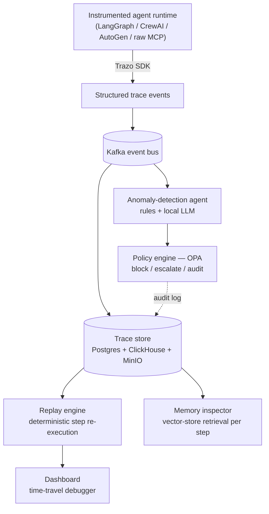

# Trazo

**Observability, replay, and governance for multi-agent AI systems.**

[](LICENSE)


*Trazo* is Spanish and Portuguese for a drawn stroke — the mark a pen leaves behind. That mark, applied to an agent's execution, is what this project is about: the durable, inspectable record of what an autonomous system actually did, as opposed to what its logs claim it did.

---

## The problem

Multi-agent LLM systems built on LangGraph, CrewAI, AutoGen, or raw MCP tool-calling loops fail in production in ways that are hard to see and harder to explain. An agent loops on the same tool call forty times before a timeout kills it. A budget guard trips at 2 a.m. because a planning step spiraled into recursive sub-tasks. A retrieval step pulls the wrong document and the agent confidently acts on it three steps later, far from where the actual mistake happened.

When this happens, the honest answer to "why did the agent do that" is usually: nobody knows, and there is no way to find out short of re-reading unstructured logs and guessing. Standard application observability (traces, metrics, logs) was built for systems where a request either succeeds or fails in a deterministic, mostly-linear way. Agent systems are neither — they branch on model output, hold long-lived state across many LLM calls, read and write memory, and make irreversible tool calls whose consequences aren't visible in a stack trace.

This is the same gap application debugging faced before Sentry, and the same gap distributed workflows faced before Temporal. It shows up the moment a team moves an agent from "impressive demo" to "runs unsupervised in production," and it does not go away as models get better — a more capable model still makes decisions you need to be able to inspect, replay, and, when necessary, stop before they execute.

## What exists today, and where it falls short

- **LangSmith** is well integrated with LangChain/LangGraph but is closed-source and hosted-only — you cannot self-host it or point it at a CrewAI or AutoGen agent.
- **Langfuse** is open-source and framework-agnostic, with solid tracing and evaluation support. Its run viewer lets you *look at* a past execution, but it does not deterministically *re-execute* one step at a time against the original state.
- **Arize Phoenix** is strong on evaluation and dataset-driven quality metrics, but it is built for measuring output quality, not for stepping through a single failing run to find where control flow went wrong.
- **OpenTelemetry's GenAI semantic conventions** standardize what a span for an LLM call looks like, which is genuinely useful, but OTel is a transport and schema layer — it has no opinion on replay, agent-specific failure detection, or pre-execution policy enforcement.

None of these give you a deterministic, step-by-step replay of a specific failed run, a way to unify traces across more than one agent framework, or a way to block an action *before* it executes based on a policy evaluated against the trace. That combination is what Trazo is for.

## What Trazo is

Trazo is an instrumentation SDK, trace store, and replay runtime for agent systems, plus two layers built on top of the trace data: an anomaly-detection agent that watches other agents' execution for known failure signatures, and a policy engine that can block or escalate an action before it runs.

The design goal is to be the layer that sits between agent frameworks (LangGraph, CrewAI, AutoGen) and the people who have to keep agents built on them running correctly — the same relationship Datadog has to application code, or Temporal has to workflow code, except purpose-built for the way agent systems actually fail.

## Architecture



**Instrumentation SDK.** A Python (and later TypeScript) library that hooks into an agent framework's execution and emits structured trace events: state transitions, tool calls and their results, memory reads and writes, inter-agent messages, planning steps, and human-in-the-loop checkpoints. The event schema is designed to be framework-agnostic — a LangGraph state transition and a CrewAI task handoff both normalize to the same underlying event shape, and the schema is being kept close to OpenTelemetry's GenAI semantic conventions rather than reinventing a competing one, so existing OTel tooling isn't a dead end.

**Ingestion and trace store.** Trace events flow through Kafka into Postgres for structured querying, with ClickHouse as an option for high-volume trace analytics, and MinIO for large tool-output payloads (a 200KB scraped webpage doesn't belong in a relational row). Every event is a resumable, individually addressable unit — that granularity is what replay depends on.

**Replay engine.** The core technical bet of this project. See [Replay under non-determinism](#replay-under-non-determinism) below — this is the piece that separates Trazo from a trace viewer.

**Anomaly-detection agent.** A meta-agent that watches other agents' traces for degenerate patterns — infinite tool-call loops, budget runaways, tool-call thrashing, goal drift from the original task. It combines cheap rule-based heuristics (a tool called with near-identical arguments N times in a row) with a local LLM classifier (Qwen2.5, served via Ollama) for the harder, more semantic case of drift, where the agent is doing *something*, just not the thing it was asked to do.

**Policy and governance engine.** Guardrails evaluated with Open Policy Agent against each trace event *before* the corresponding action executes — for example, "block this tool call if projected cost exceeds $X" or "escalate to a human if this action touches a production data store." This is deliberately not a passive audit log: enforcement happens inline, which is what makes it a governance layer rather than a reporting feature.

**Memory inspector.** Visualizes what an agent's memory or vector-store retrieval actually returned at each step. Retrieval-driven mistakes are common and usually invisible in a normal trace view, because the trace shows the agent's *decision*, not what it was looking at when it made it.

**Dashboard.** A React frontend for the trace timeline, the step-by-step replay view, and per-step cost/latency/quality metrics.

## Replay under non-determinism

This is the part of the system most likely to be either the most interesting technical contribution here or the part that quietly gets faked, so it's worth being precise about what "replay" means and does not mean.

LLM completions are sampled. Even at temperature zero, model providers rotate weights and deprecate versions without notice, and any tool call that touches the outside world — a web search, a database query, a third-party API — can return a different result five minutes later. This means that literally re-running the same agent code against the same input will not, in general, reproduce the same trace. A replay tool that just "runs it again" is not replaying anything; it's producing a second, different, uncorrelated run.

Temporal solved an adjacent problem for general-purpose workflow code the same way: it doesn't require workflow code to be pure, it requires every non-deterministic operation (an "Activity") to have its result recorded in the workflow history, and replay re-executes the workflow's control flow while satisfying every one of those operations from the recorded history instead of a live call. The workflow code runs again; the outside world does not.

Trazo applies the same idea to agent execution. Every LLM completion, tool call, memory read, and external side effect during an instrumented run is captured verbatim as a checkpointed trace event. Replay re-drives the agent's control flow forward and, at each point where the original run made a non-deterministic call, substitutes the recorded value instead of issuing a live one. The result is that you can step through exactly what the agent saw and decided at step *N* of a specific historical run — not an approximation, not a "similar-looking" re-run.

What this buys you: faithful, inspectable reconstruction of a specific failure, and — as a further-out capability, not part of the initial scope — the ability to fork from a given step with one input or tool response changed, to see where a different outcome would have branched off. What it does not buy you: prediction of what the agent would do on a genuinely fresh run with fresh sampling, which is a different problem (closer to evaluation than debugging) and is out of scope for the replay engine specifically.

The two research questions this raises — how to define and measure "replay fidelity" when the underlying system is stochastic, and what the actual replay overhead is at scale — are the first entries in [Research direction](#research-direction) below, precisely because they don't have settled answers yet.

## Design preview: target developer experience

Nothing below is implemented yet — no package exists to install. This is included because architecture is easier to evaluate when you can see the shape of the API it implies, not just the boxes in a diagram. Treat it as a preview of the target design, subject to change once real usage puts pressure on it.

```python
# Instrumenting a LangGraph agent
from trazo.integrations.langgraph import instrument

graph = build_research_agent_graph()
traced_graph = instrument(graph, project="research-assistant")

result = traced_graph.invoke({"query": "..."})
# every state transition, tool call, and memory access in this run
# is now a durable, individually addressable trace event
```

```python
# Replaying a specific historical run, step by step
from trazo import replay

run = replay.load("run_8f21ac")

for step in run.steps():
    print(step.index, step.kind, step.state_before, step.decision)
    # step.decision.tool_call, step.decision.args, etc. are the
    # *recorded* values from the original run, not freshly generated ones
```

```yaml
# A policy evaluated inline, before the action it governs executes
package trazo.policies

deny[msg] {
    input.tool_call.name == "send_email"
    input.projected_cost_usd > 5
    msg := "blocked: projected cost exceeds per-action budget"
}
```

## Project status

This repository is in the architecture and design phase. The problem statement, system design, and technical bets above are settled; the implementation is not yet started. There is no installable package, no running dashboard, and no benchmark results — any of those claims elsewhere on the internet about this project should be treated as aspirational until this section says otherwise.

| Component | Status |
|---|---|
| Trace event schema | Designed, not yet implemented |
| Instrumentation SDK (Python) | Not started |
| LangGraph adapter | Not started |
| CrewAI adapter | Not started |
| AutoGen adapter | Not started |
| Ingestion pipeline (Kafka → Postgres/ClickHouse/MinIO) | Not started |
| Replay engine | Not started — the core open technical problem |
| Anomaly-detection agent | Not started |
| Policy engine (OPA integration) | Not started |
| Memory inspector | Not started |
| Dashboard | Not started |

## Roadmap

The roadmap is ordered by dependency, not by calendar. Each phase produces something demonstrable, because the biggest risk to a project like this is polishing the easy 80% (a nice trace timeline) while quietly never building the hard 20% (real replay) that justifies the project existing.

1. **Foundations.** Finalize the trace event schema; stand up the Kafka → Postgres ingestion path; ingest a hand-crafted test trace end to end.
2. **Single-framework tracing.** Instrumentation SDK v1 wraps a LangGraph agent; a raw trace timeline is visible in a minimal dashboard.
3. **Cross-framework + demo agents.** Add CrewAI and AutoGen adapters; build three demo agents (a research assistant, a content pipeline, a coding agent) that generate realistic, non-trivial traces.
4. **Replay engine v1.** Deterministic step-by-step replay of a cached run, verified by checking that replayed state matches the original at every step — this is the milestone the rest of the project's credibility rests on.
5. **Failure injection + anomaly detection.** A harness that deliberately induces loops, budget overruns, and goal drift in the demo agents; a hybrid rule + local-LLM detector measured against those injected failures.
6. **Policy and memory.** OPA-based guardrails wired into the trace pipeline; the memory inspector for vector-store retrieval visualization.
7. **Benchmark and release.** A public benchmark measuring replay fidelity and anomaly-detection precision/recall/false-positive rate across all three frameworks; first tagged release of the SDK and platform.

## Research direction

Three open questions motivate the architecture above. None of these are solved by existing tooling, and none are claimed as solved here — they are the reason this project is structured the way it is, and they're listed as questions rather than results on purpose.

1. **Deterministic replay for non-deterministic multi-agent systems.** Can step-by-step replay of an agent run be made reliable, using checkpointed state and recorded tool/model I/O, in a way that generalizes across LangGraph, CrewAI, and AutoGen rather than being bespoke to one? The relevant metrics are a replay-fidelity rate (does replayed state match the original at each step) and replay overhead.
2. **A failure taxonomy and detection framework for agentic workflows.** What are the recurring failure signatures in multi-agent execution — loops, budget runaways, tool-call thrashing, goal drift — and can a lightweight hybrid detector (rules plus a small local model) catch them reliably? The relevant metrics are precision/recall against injected failures and, just as important, the false-positive rate against runs that are unusual but legitimate.
3. **An open benchmark for agent-observability tooling.** The field currently has no shared way to evaluate a tool like this one. A reproducible benchmark — failure-injected traces across multiple frameworks, with defined ground truth — would be a reusable artifact independent of whether Trazo specifically succeeds, in the same spirit MLPerf gave general ML benchmarking a shared reference point.

## Technology stack

Every dependency below is free for self-hosted use, including commercial use, with no academic-license restrictions.

| Layer | Choice | Why |
|---|---|---|
| Control plane API | FastAPI | Async-native, minimal ceremony for the ingestion and query surface |
| Event bus | Apache Kafka (self-hosted) | Durable, replayable event log — a natural fit given the platform's own subject matter |
| Trace store | PostgreSQL, optional ClickHouse/TimescaleDB | Postgres for structured trace metadata and queries; ClickHouse as an opt-in for high-volume analytical workloads |
| Large payload storage | MinIO (S3-compatible) | Tool outputs and scraped content don't belong in relational rows |
| Real-time fan-out | Redis | Streams live trace events to the dashboard as a run executes |
| Vector store | Qdrant or ChromaDB | Backing store for the memory inspector |
| Local LLM inference | Ollama running Qwen2.5-7B/14B | Zero-cost, self-hosted reasoning for the anomaly-detection agent; the model is a pluggable default, not a hard dependency |
| Policy engine | Open Policy Agent | Mature, declarative policy evaluation rather than hand-rolled guardrail logic |
| Frontend | React, hosted on Cloudflare Pages | Free static/edge hosting for the dashboard |
| Auth | Supabase (free tier) | Off-the-shelf auth rather than building it |
| Platform observability | Prometheus + Grafana | Trazo observes agents; it should be observable itself the same way |
| Local orchestration | Docker, Minikube/Kind | Reproducible local environment for the full pipeline |
| CI/CD | GitHub Actions | Free tier is sufficient for this project's scope |

## Who this is for

The intended user is the engineer who gets paged when an agentic system misbehaves in production — the same audience LangChain, CrewAI, and Langfuse already serve, specifically on the debugging and governance layer that's currently underserved. If your team runs LangGraph, CrewAI, AutoGen, or a hand-rolled MCP agent loop past the demo stage, this is meant for you.

The intended model, once there is something to ship, is open-core: the SDK, self-hosted trace store, and replay engine are meant to stay free and open. A hosted tier — managed trace storage at scale, more capable anomaly-detection models, SSO/RBAC, and audit-compliance features — is the planned path to sustaining the project, not a current product. Nothing in this section describes revenue that exists today.

## Contributing

There's no code yet, which means the highest-leverage way to contribute right now is on the design: the trace event schema, the replay engine's checkpoint model, and the failure taxonomy in [Research direction](#research-direction) all benefit more from scrutiny before implementation than after. Open an issue before sending a large pull request — for a project this early, aligning on design saves more time than it costs.

## License

MIT. See [LICENSE](LICENSE).
